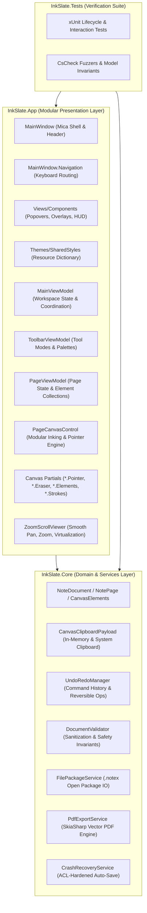
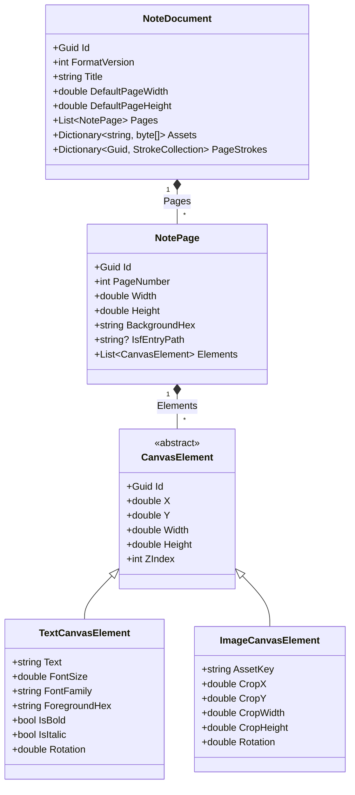
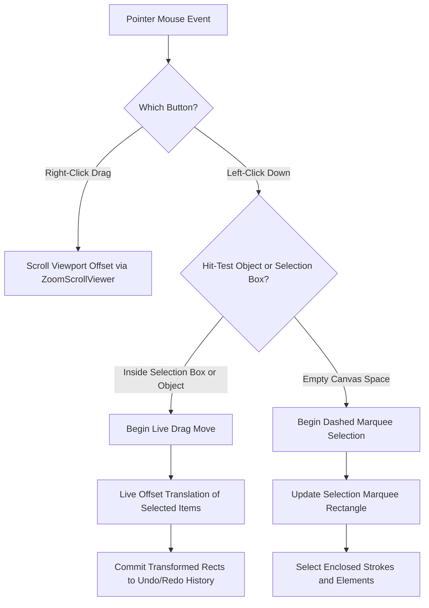

# InkSlate Architecture & Internals

This document details the architectural design, core systems, serialization formats, rendering pipelines, and security guardrails of **InkSlate**.

---

## 1. Architectural Overview & Component Boundaries

InkSlate follows clean architectural separation between domain logic, data models, persistence, and the presentation layer:



### Layer Responsibilities
- **`InkSlate.Core`**:
  - Independent of any specific UI framework controls (only references WPF drawing primitive contracts such as `StrokeCollection` and `DrawingAttributes` via Windows Desktop targeting).
  - Owns all data models (`NoteDocument`, `NotePage`, `TextCanvasElement`, `ImageCanvasElement`).
  - Owns the clipboard data interchange payload (`CanvasClipboardPayload`).
  - Contains deterministic serialization logic (`FilePackageService`, `DocumentValidator`).
  - Hosts the vector rendering engine (`PdfExportService` using SkiaSharp).
  - Hosts the background auto-save crash recovery service (`CrashRecoveryService`).
  - Hosts the undo/redo engine (`UndoRedoManager`).
- **`InkSlate.App`**:
  - Pure WPF presentation shell targeting .NET 10.
  - Implements MVVM with `CommunityToolkit.Mvvm` (`ObservableObject`, `[ObservableProperty]`, `[RelayCommand]`).
  - Integrates modern Windows 11 styling via `WPF-UI` (Mica backdrop, Fluent typography, acrylic popovers).
  - Decomposed into modular components and partial classes to maintain strict file length hygiene:
    - **Modular UserControls (`Views/Components/`)**: `PenOptionsPopover`, `EraserOptionsPopover`, `LassoFilterPopover`, `TextOptionsPopover`, `PageSetupPopover`, `PdfExportPopover`, `CustomPenOverlay`, `StatusHudOverlay`, `HelpShortcutsOverlay`.
    - **Modular Canvas Partial Classes (`Controls/`)**: `PageCanvasControl.Pointer.cs`, `PageCanvasControl.Eraser.cs`, `PageCanvasControl.Elements.cs`, `PageCanvasControl.Strokes.cs`.
    - **Modular Navigation Partial Class (`Views/`)**: `MainWindow.Navigation.cs` handles all shortcut dispatch and navigation keys.
    - **Shared Resource Dictionary (`Themes/SharedStyles.xaml`)**: Centralizes reusable brushes, converters, shadow effects, and popover container styles.
  - Hosts custom high-performance controls (`PageCanvasControl`, `ZoomScrollViewer`, `CanvasElementAdorner`).
- **`InkSlate.Tests`**:
  - Comprehensive unit and property-based verification (`xUnit`, `CsCheck`).
  - Runs with `/p:TreatWarningsAsErrors=true` in `Release` configuration.

---

## 2. Document Model & Polymorphism

### Data Hierarchy



### Polymorphic Serialization
Canvas elements serialize via System.Text.Json polymorphic source generators:
```csharp
[JsonPolymorphic(TypeDiscriminatorPropertyName = "kind")]
[JsonDerivedType(typeof(TextCanvasElement), typeDiscriminator: "text")]
[JsonDerivedType(typeof(ImageCanvasElement), typeDiscriminator: "image")]
public abstract class CanvasElement { ... }
```

---

## 3. The `.notex` Open Storage Format

An InkSlate document (`.notex`) is an open ZIP archive engineered for deterministic persistence, cross-platform readability, and fast random access:

```
document.notex (ZIP Archive)
├── manifest.json              # UTF-8 JSON document model & element layout
├── pages/
│   ├── 018f3a2c-...-0001.isf   # Binary ISF vector strokes for Page 1
│   └── 018f3a2c-...-0002.isf   # Binary ISF vector strokes for Page 2
└── assets/
    ├── 018f3a2c-...-img1.png  # Embedded media (PNG/JPEG/BMP)
    └── 018f3a2c-...-img2.jpg
```

### Security & Integrity Policy
1. **Zip Slip Prevention**:
   - Rejects any entry containing `..`, absolute root indicators (`/`, `\`), or Windows drive delimiters (`:`).
2. **Zip Bomb & Quota Guards**:
   - Max archive file size: `500 MB`.
   - Max archive entry count: `2,000`.
   - Max `manifest.json` uncompressed size: `5 MB`.
   - Max per-page ISF stroke stream: `15 MB`.
   - Max individual asset size: `25 MB`.
   - Max cumulative uncompressed size: `500 MB`.
   - Reads through `BoundedReadStream` wrapping every entry, throwing `InvalidDataException` immediately if quota is breached.
3. **Atomic File Commitment**:
   - Documents save to `{targetPath}.tmp.{guid}` and commit via `File.Move(..., overwrite: true)` to prevent corruption during system interruption.

---

## 4. Undo / Redo Command Architecture

The undo/redo engine uses an atomic, reversible command pattern managed by [`UndoRedoManager`](file:///d:/MyProject/ink-slate/InkSlate.Core/UndoRedo/UndoRedoManager.cs):

```csharp
public interface IUndoableOperation
{
    string Description { get; }
    void Undo();
    void Redo();
}
```

### Operation Catalog
- `StrokesChangedOperation`: Tracks added and removed strokes per page.
- `ElementAddedOperation` / `ElementRemovedOperation`: Tracks element additions and deletions.
- `ElementTransformedOperation`: Captures previous and new geometric rectangles (`Rect`) for position and dimension changes.
- `CompositeOperation`: Bundles multiple simultaneous modifications (e.g. lasso deleting 10 strokes and 2 text cards) into a single atomic undo transaction.

---

## 5. SkiaSharp Vector PDF Rendering Pipeline

The export pipeline converts the document coordinate space directly into vector PDF instructions:

1. **Coordinate Mapping**:
   - Document dimensions are defined in Device Independent Pixels (DIPs, 96 DPI).
   - SkiaSharp initializes `SKDocument.CreatePdf(stream, 96f)`.
   - 1 DIP maps exactly to 0.75 PDF points ($72/96$), ensuring pixel-perfect dimensional accuracy.
2. **Vector Stroke Tessellation**:
   - Inking points are parsed and tessellated as cubic Bézier curves (`SKPath.CubicTo`).
   - Pen tips support both circular (`SKStrokeCap.Round`) and rectangular (`SKStrokeCap.Square`) tips.
   - Highlighters render with transparency blend modes matching WPF compositing.
3. **Typography**:
   - Text elements wrap across boundaries using `SKPaint` font metric measurements.
4. **Media Rendering**:
   - Image elements decode from stored byte arrays into `SKImage`, support sub-rectangle cropping (`CropX`, `CropY`, `CropWidth`, `CropHeight`), and draw directly into the target PDF canvas.

---

## 6. Virtualization & Memory Optimization

1. **Page Dehydration & Recycling**:
   - In consecutive view mode, `PageCanvasControl` controls outside the viewport cache are unloaded by `VirtualizingStackPanel`.
   - When `Unloaded` fires, event handlers (`StrokeCollected`, `SelectionChanged`, `StrokesChanged`) are detached to prevent detached visual controls from staying rooted in memory.
   - Idempotent `Loaded` handlers re-synchronize state when scrolled back into view.
2. **Resource Freezing**:
   - Static adorners, border pens, accent brushes, and shadows are frozen using `.Freeze()` and `po:Freeze="True"`.
   - Page backgrounds use `HexToFrozenBrushConverter` to ensure brushes are cached and immutable across frames.

---

## 7. Pointer Tool, Selection & Live Manipulation Pipeline

The pointer tool (`ToolMode.Pointer`) coordinates selection, dragging, and panning across strokes and canvas elements without mode collisions:



### 1. Right-Click Drag Viewport Panning
- Right-click mouse down captures mouse input and records initial screen coordinates.
- Mouse move calculates delta displacement and directly applies opposing scroll offsets to `ZoomScrollViewer`.
- Releases mouse capture on right button release without affecting tool selection or canvas focus.

### 2. Single-Object Hit-Testing & Multi-Type Selection
- Left-click executes hierarchical hit-testing:
  1. **Canvas Elements**: Queries visual element containers and checks geometric bounds (`Rect.Contains(point)`).
  2. **Ink Strokes**: Executes `InternalInkCanvas.Strokes.HitTest(point, 8)` to isolate single strokes under the pointer.
- Clicking an unselected object deselects previous objects and selects the target.
- Clicking inside an already-selected object or bounding box maintains the active selection and transitions immediately into drag mode.

### 3. Live Drag-Move Engine
- Tracks displacement delta $(\Delta x, \Delta y)$ between pointer move events.
- Concurrently shifts both `CanvasElement` coordinate positions (`element.X += dx`, `element.Y += dy`) and stroke points (`stroke.Transform(matrix, false)`).
- Recomputes and updates the dashed selection rectangle in real-time.
- On mouse release, changes commit as a single undoable transaction (`ElementTransformedOperation` or composite operation).

### 4. Marquee Drag Selection
- Clicking empty space clears current selections and records the marquee drag anchor.
- Moving the mouse sizes a dashed blue marquee rectangle.
- Strokes whose bounding boxes intersect the marquee and elements enclosed by the rectangle are highlighted and selected.

### 5. Selection Visual State & Dynamic Cursors
- When an object or group is selected, `PageCanvasControl` updates the mouse cursor:
  - Inside the selection bounds: `Cursors.SizeAll` (indicating drag-to-move capability).
  - Outside the selection bounds: default pointer cursor.
- When the selected object is deleted (`DeleteSelected()`), the selection box and adorner are immediately cleared.

---

## 8. Clipboard Pipeline & Cursor Coordinate Mapping

InkSlate supports rich cross-object copy and paste with precise cursor placement:

### 1. Payload Serialization
- Selected elements (Text, Image) and strokes clone into a `CanvasClipboardPayload` instance.
- Deep clones are generated so modifications to original objects do not taint clipboard content.

### 2. Cursor-Targeted Insertion
- `MainWindow.GetCurrentCanvasCursorPosition()` maps screen pointer coordinates through the visual tree to the active `PageCanvasControl.InternalInkCanvas`.
- When `Ctrl+V` executes:
  - If the cursor is over a page canvas, the copied items are placed directly at that position.
  - If the cursor is outside the canvas, items default to the active page center.
  - Newly pasted items are immediately selected, deselecting previous items so the user can immediately drag or transform the pasted duplicate.


