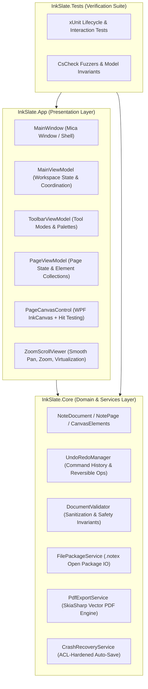
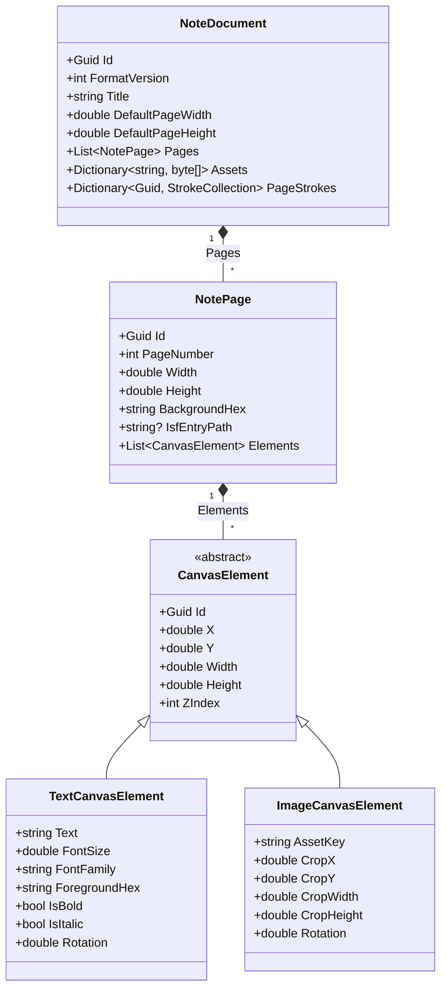

# InkSlate Architecture & Internals

This document details the architectural design, core systems, serialization formats, rendering pipelines, and security guardrails of **InkSlate**.

---

## 1. Architectural Overview & Component Boundaries

InkSlate follows clean architectural separation between domain logic, data models, persistence, and the presentation layer:



### Layer Responsibilities
- **`InkSlate.Core`**:
  - Independent of any specific UI framework controls (only references WPF drawing primitive contracts such as `StrokeCollection` and `DrawingAttributes` via Windows Desktop targeting).
  - Owns all data models (`NoteDocument`, `NotePage`, `TextCanvasElement`, `ImageCanvasElement`).
  - Contains deterministic serialization logic (`FilePackageService`, `DocumentValidator`).
  - Hosts the vector rendering engine (`PdfExportService` using SkiaSharp).
  - Hosts the background auto-save crash recovery service (`CrashRecoveryService`).
  - Hosts the undo/redo engine (`UndoRedoManager`).
- **`InkSlate.App`**:
  - Pure WPF presentation shell targeting .NET 10.
  - Implements MVVM with `CommunityToolkit.Mvvm` (`ObservableObject`, `[ObservableProperty]`, `[RelayCommand]`).
  - Integrates modern Windows 11 styling via `WPF-UI` (Mica backdrop, Fluent typography, acrylic popovers).
  - Hosts custom high-performance controls (`PageCanvasControl`, `ZoomScrollViewer`, `CanvasElementAdorner`).
- **`InkSlate.Tests`**:
  - Comprehensive unit and property-based verification (`xUnit`, `CsCheck`).
  - Runs with `/p:TreatWarningsAsErrors=true` in `Release` configuration.

---

## 2. Document Model & Polymorphism

### Data Hierarchy



### Polymorphic Serialization
Canvas elements serialize via System.Text.Json polymorphic source generators:
```csharp
[JsonPolymorphic(TypeDiscriminatorPropertyName = "kind")]
[JsonDerivedType(typeof(TextCanvasElement), typeDiscriminator: "text")]
[JsonDerivedType(typeof(ImageCanvasElement), typeDiscriminator: "image")]
public abstract class CanvasElement { ... }
```

---

## 3. The `.notex` Open Storage Format

An InkSlate document (`.notex`) is an open ZIP archive engineered for deterministic persistence, cross-platform readability, and fast random access:

```
document.notex (ZIP Archive)
├── manifest.json              # UTF-8 JSON document model & element layout
├── pages/
│   ├── 018f3a2c-...-0001.isf   # Binary ISF vector strokes for Page 1
│   └── 018f3a2c-...-0002.isf   # Binary ISF vector strokes for Page 2
└── assets/
    ├── 018f3a2c-...-img1.png  # Embedded media (PNG/JPEG/BMP)
    └── 018f3a2c-...-img2.jpg
```

### Security & Integrity Policy
1. **Zip Slip Prevention**:
   - Rejects any entry containing `..`, absolute root indicators (`/`, `\`), or Windows drive delimiters (`:`).
2. **Zip Bomb & Quota Guards**:
   - Max archive file size: `500 MB`.
   - Max archive entry count: `2,000`.
   - Max `manifest.json` uncompressed size: `5 MB`.
   - Max per-page ISF stroke stream: `15 MB`.
   - Max individual asset size: `25 MB`.
   - Max cumulative uncompressed size: `500 MB`.
   - Reads through `BoundedReadStream` wrapping every entry, throwing `InvalidDataException` immediately if quota is breached.
3. **Atomic File Commitment**:
   - Documents save to `{targetPath}.tmp.{guid}` and commit via `File.Move(..., overwrite: true)` to prevent corruption during system interruption.

---

## 4. Undo / Redo Command Architecture

The undo/redo engine uses an atomic, reversible command pattern managed by [`UndoRedoManager`](file:///d:/MyProject/ink-slate/InkSlate.Core/UndoRedo/UndoRedoManager.cs):

```csharp
public interface IUndoableOperation
{
    string Description { get; }
    void Undo();
    void Redo();
}
```

### Operation Catalog
- `StrokesChangedOperation`: Tracks added and removed strokes per page.
- `ElementAddedOperation` / `ElementRemovedOperation`: Tracks element additions and deletions.
- `ElementTransformedOperation`: Captures previous and new geometric rectangles (`Rect`) for position and dimension changes.
- `CompositeOperation`: Bundles multiple simultaneous modifications (e.g. lasso deleting 10 strokes and 2 text cards) into a single atomic undo transaction.

---

## 5. SkiaSharp Vector PDF Rendering Pipeline

The export pipeline converts the document coordinate space directly into vector PDF instructions:

1. **Coordinate Mapping**:
   - Document dimensions are defined in Device Independent Pixels (DIPs, 96 DPI).
   - SkiaSharp initializes `SKDocument.CreatePdf(stream, 96f)`.
   - 1 DIP maps exactly to 0.75 PDF points ($72/96$), ensuring pixel-perfect dimensional accuracy.
2. **Vector Stroke Tessellation**:
   - Inking points are parsed and tessellated as cubic Bézier curves (`SKPath.CubicTo`).
   - Pen tips support both circular (`SKStrokeCap.Round`) and rectangular (`SKStrokeCap.Square`) tips.
   - Highlighters render with transparency blend modes matching WPF compositing.
3. **Typography**:
   - Text elements wrap across boundaries using `SKPaint` font metric measurements.
4. **Media Rendering**:
   - Image elements decode from stored byte arrays into `SKImage`, support sub-rectangle cropping (`CropX`, `CropY`, `CropWidth`, `CropHeight`), and draw directly into the target PDF canvas.

---

## 6. Virtualization & Memory Optimization

1. **Page Dehydration & Recycling**:
   - In consecutive view mode, `PageCanvasControl` controls outside the viewport cache are unloaded by `VirtualizingStackPanel`.
   - When `Unloaded` fires, event handlers (`StrokeCollected`, `SelectionChanged`, `StrokesChanged`) are detached to prevent detached visual controls from staying rooted in memory.
   - Idempotent `Loaded` handlers re-synchronize state when scrolled back into view.
2. **Resource Freezing**:
   - Static adorners, border pens, accent brushes, and shadows are frozen using `.Freeze()` and `po:Freeze="True"`.
   - Page backgrounds use `HexToFrozenBrushConverter` to ensure brushes are cached and immutable across frames.

